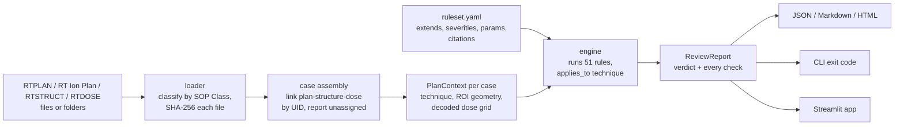

# RT-Plan Guardian

**Automated radiotherapy plan consistency & safety checker** for **photon, electron, proton/ion and brachytherapy** plans.
Cross-checks DICOM-RT plan, structure-set and dose files against configurable, **source-cited rulesets** and produces an **auditable report that shows exactly which rules passed, failed, or could not run**.

`Python 3.10+` · `pydicom` · `DICOM-RT` · `pytest` · `Streamlit`

> **Decision-support tool, not a medical device.** It does not replace independent physics plan review or your treatment-planning system's own verification. Read [docs/safety-and-limitations.md](docs/safety-and-limitations.md) before using it near patient data.

---

## Why

A plan can be internally valid DICOM and still be wrong *as a set*: the dose file belongs to last week's revision, the prescription was edited but the beam doses were not, an ROI was renumbered, two files come from different patients, an MLC leaf pair crosses, a brachytherapy total air kerma no longer matches its dwell times. Humans catch these in chart review, but a checklist done by eye is slow and inconsistent. RT-Plan Guardian turns the cross-object checks into code that runs in seconds and leaves a record.

## Quickstart

```bash
python -m venv .venv && source .venv/bin/activate
pip install -e ".[dev,app]"          # drop "app" if you don't need the web UI

rtpg demo demo_case                          # synthetic photon plan - no patient data needed
rtpg demo demo_proton --technique proton     # also: electron, brachy
rtpg check demo_case --out reports           # exit code 0 = pass
rtpg demo demo_bad --defect prescription_mismatch && rtpg check demo_bad   # exit code 1
rtpg check /path/to/export_folder            # several plans in one folder -> one review per case
rtpg check case/ --config hytec_brain_srs    # a built-in, source-cited ruleset (see `rtpg rulesets`)
rtpg app                                     # Streamlit UI (upload files or run the demo)
```

### Real output on real data

Open-access Gamma Knife files (TCIA Vestibular-Schwannoma-SEG, CC BY 4.0): one folder holding 2 plans,
2 doses and 2 structure sets is assembled into 2 cases by following the UID references the files carry.

```text
$ rtpg check open_data/gamma_knife/VS-SEG-001
Assembled 2 cases from the supplied files.

Case Plan1-copy_470263  (technique: photon)
  RTPLAN    00000001.dcm
  RTSTRUCT  00000001.dcm
  RTDOSE    00000001.dcm

WARN  STRUCT-005 Every ROI has an interpreted type - 4 of 4 checks failed
WARN  BEAM-008   Beam-limiting devices are declared consistently with their positions - 19 of 19 checks failed
WARN  DOSE-006   Target coverage (DVH point) meets the prescription - 1 of 1 checks failed
      - Target ROI 1 'TV' D95 >= 95% of 13 Gy: observed '0.01 Gy (0.1%)', expected '>= 12.35 Gy' (3445 voxels sampled)

Verdict: PASS_WITH_WARNINGS  (28 passed, 0 failed, 3 warnings, 0 not evaluated, 0 crashed, 20 n/a, 0 disabled)
```

That DOSE-006 warning is real: this dose file peaks 40 mm away from the plan's own shots. Full account,
including everything the real data broke in the first version of the tool:
[docs/real-data-evaluation.md](docs/real-data-evaluation.md).

`--out` writes the same result as **JSON** (machines), **Markdown** (PR / ticket / chart round) and a **self-contained HTML** page (sign-off; no external requests, dark-mode aware).

## What it covers

| Technique | DICOM objects | Technique-specific rules | Verified on |
|---|---|---|---|
| Photon (linac, cobalt, Gamma Knife) | RT Plan | MLC/jaw physics and declarations, MU per dosimeter unit (MU/MINUTE), isocentre-in-target, hotspot/coverage screens, **prescription isodose** (radiosurgery) | synthetic + **real Gamma Knife plans (8)** |
| Electron | RT Plan | applicator, cutout (aperture block), SSD (MPPG 11.a Table 9 items) | synthetic only |
| Proton / ion | **RT Ion Plan** | scan mode, spot maps and weights, **two-control-points-per-segment model**, energy range, scan field, range shifter/snout | synthetic only (no open real data exists) |
| Brachytherapy (HDR/LDR) | RT Plan + application setups | source definition, **total reference air kerma identity**, channel/dwell structure, source strength vs decay, fraction scheme, step size | synthetic + **real Varian and Elekta HDR plans (4)** |

Plus everything common to all techniques: identity, UID linkage, structure-set integrity, prescription arithmetic, dose-grid integrity, and protocol constraints.

## How it works



Every rule yields small **`Check`** records (*subject, observed, expected, ok*). A rule with ten beams yields ten checks, so a reviewer sees which beam failed and what was compared with what, not just "BEAM-003 failed".

### Rules (51, in 11 categories)

| Category | Rules | Examples |
|---|---|---|
| Input | 3 | required objects; unassigned objects; one plan-level dose |
| Identity | 3 | PatientID / name / DOB agree; SOP Instance UIDs unique |
| Linkage | 4 | plan→structure set UID, dose→plan UID, shared Frame of Reference, dose-reference ROIs exist |
| Structure | 6 | ROI numbering, required ROIs, empty ROIs, contour geometry per type, interpreted types, **TG-263 names** |
| Plan | 5 | approval, deliverable content, fractions, **prescription = per-fraction dose x fractions**, machine |
| Beam | 8 | beam↔fraction-group references, control points, angles, energy, meterset per unit, isocentre in target, **crossed MLC leaves**, device declarations |
| Ion | 6 | scan parameters, spot maps, **segment pairing and weight sums**, energy range, scan field, range shifter/snout |
| Electron | 3 | applicator, cutout, SSD |
| Brachy | 6 | sources, **TRAK identity**, channels/dwell pairs, source decay/reference date, fraction scheme, dwell time/step |
| Dose | 6 | units/type, grid integrity, resolution, hotspot, target-inside-grid, **target D95 coverage** |
| Protocol | 1 | **dose-volume constraints from a cited ruleset** (Dmax, D95%, D2cc, V12Gy, V95%...) |

Full list with rationale, references and parameters: [docs/rule-catalog.md](docs/rule-catalog.md) (generated from code; a test fails if it drifts). `rtpg rules` prints it in the terminal.

### Official-source rulesets

Numeric clinical limits are never hard-coded in a rule: they live in rulesets that cite the document they came from, and the citation is embedded in every report. Built in (`rtpg rulesets`):

| Ruleset | Source | Encodes |
|---|---|---|
| `default` | DICOM PS3.3; AAPM MPPG 11.a | structural checks, placeholder thresholds, no clinical numbers |
| `aapm_mppg11a` | AAPM MPPG 11.a (CC BY 4.0), Tables 7-9 | the initial-review items DICOM-RT can verify, as blocking |
| `hytec_brain_srs` | HyTEC, Milano et al., IJROBP 2021 | normal brain V12Gy ≤ 10 cc (brain minus target), single-fraction SRS |
| `tg263_naming` | AAPM TG-263, Mayo et al., IJROBP 2018 | standard structure names (list supplied locally; not redistributed) |

Only documents that could be read and verified are encoded, and what was *not* encoded is said explicitly: see [docs/standards-provenance.md](docs/standards-provenance.md). Rulesets can `extends` each other:

```yaml
ruleset: { name: My clinic SRS, extends: hytec_brain_srs }
rules:
  PLAN-005: { params: { allowed_machines: [LINAC1] } }
  DVH-001:  { params: { constraints: [ { id: BRAINSTEM-D0.1CC, roi: ["^Brainstem$"], metric: "D0.1cc",
              op: "<=", limit: 12.5, unit: Gy, source: "your protocol, section X" } ] } }
```

Rules you don't list still run with defaults. **Typos fail loudly**: an unknown rule id or parameter name is a load error, and every dose-volume constraint must cite a source.

## Audit properties

* **Nothing is dropped.** Every rule ends in exactly one status: `PASS`, `FAIL`, `NOT_APPLICABLE` (wrong technique / nothing to check), `SKIPPED` (could not run: missing/unsupported data), `ERROR` (the rule crashed), or `DISABLED` (by ruleset).
* **Unknown is never a pass.** A skipped rule is listed as skipped; a crashing rule downgrades the verdict to `INCOMPLETE`; a rule that checked nothing is an `ERROR`; an unverifiable constraint (ROI absent) fails.
* **Verdicts:** `PASS` · `PASS_WITH_WARNINGS` · `FAIL` · `INCOMPLETE`. Severity `error` = inconsistent/impossible/unsafe data; `warning` = outside a clinical expectation, human decides.
* **Reproducible.** Reports embed the SHA-256 of every input file and of the ruleset (and its parents), the fully resolved parameters of every rule, the ruleset's citations, and a `content_sha256` that ignores timestamps.
* **Exit codes** for CI/scripts: `0` pass · `1` fail (or warnings with `--fail-on warning`) · `2` usage/input/config error · `3` incomplete. With several cases the worst wins.

## Evidence

* **Fault injection:** a synthetic case per technique plus a catalogue of **80 realistic defects** (`rtpg demo --list`). The suite proves, for every defect, that **exactly the declared rules fail and nothing crashes**, that every clean case passes every applicable rule, and that every rule is covered by at least one defect. Adding a rule without a defect fails CI.
* **Real data:** [14 opt-in regression tests](tests/realdata/test_real_data.py) on open-access Gamma Knife and HDR brachytherapy exports from three planning systems. They turned up 11 wrong assumptions in the first version of the tool, all fixed ([evaluation](docs/real-data-evaluation.md)). Fetch with `scripts/fetch_open_data.py`; see [docs/data-sources.md](docs/data-sources.md) for licences, citations and what was not usable.

```bash
make test        # 262 tests, ~5 s
make check-all   # ruff + mypy + pytest
RTPG_REAL_DATA=$PWD/open_data pytest -m realdata     # + real-data regression tests
```

## Repository layout

```text
rt-plan-guardian/
├── src/rt_plan_guardian/
│   ├── loader.py        # classify by SOP Class UID, hash files, assemble cases by UID
│   ├── context.py       # PlanContext: one case + cached geometry + target/isodose resolution
│   ├── plan_model.py    # technique-aware accessors (BeamSequence / IonBeamSequence / brachy)
│   ├── geometry.py      # contour parsing, point-in-ROI, dose-grid decoding (numpy only)
│   ├── dvh.py           # dose-volume metrics (Dmax, D95%, D2cc, V12Gy, ...)
│   ├── rules/           # one module per category; each rule = one small class
│   ├── config.py        # strict YAML rulesets: extends, citations, built-in names
│   ├── data/rulesets/   # default, aapm_mppg11a, hytec_brain_srs, tg263_naming
│   ├── engine.py        # fail-safe rule runner, ReviewReport, verdict, content hash
│   ├── report/          # JSON · Markdown · HTML (Jinja2) renderers
│   ├── synthetic/       # per-technique synthetic cases + fault-injection catalogue
│   ├── cli.py           # rtpg check | rules | rulesets | demo | app
│   └── app.py           # Streamlit front-end (thin; no logic of its own)
├── configs/             # generated all-options template + an example site ruleset
├── scripts/             # fetch_open_data.py, tg263_xls_to_txt.py
├── docs/                # architecture, writing rules, standards, data, evaluation, safety, catalog
└── tests/               # defect matrix, engine, config, protocol, loader, report, CLI, app, realdata
```

## Documentation

* [Architecture & design principles](docs/architecture.md)
* [Real-data evaluation](docs/real-data-evaluation.md) · [Data sources & licences](docs/data-sources.md)
* [Where the rules and limits come from](docs/standards-provenance.md)
* [Writing a new rule](docs/writing-rules.md)
* [Safety, limitations & validation guidance](docs/safety-and-limitations.md)
* [Rule catalog](docs/rule-catalog.md)

## Scope & roadmap

**Current scope:** one plan per case (many cases per folder), static and arc beams, one fraction group and one prescription level for the arithmetic checks, axial dose grids, voxel-centre dose statistics.

**Least proven:** electron and proton/ion rules (no open real data exists; synthetic only). Validate them on your own anonymised exports first.

Planned: CT ↔ structure-set linkage · per-beam dose files · SIB and multi-phase prescriptions · more official constraint sets as openly readable sources allow (e.g. NRG protocol tables, EMBRACE II for cervical brachytherapy) · EQD2 conversion · machine-limit files (MLC speed, dose rate) · **signed waivers** recorded in the report · PHI-redacted reports · plugin entry points for site rules · the 23-centre linac SRS ring-trial data as the next real-data benchmark.

## License

MIT - see [LICENSE](LICENSE). Contributions welcome: see [CONTRIBUTING.md](CONTRIBUTING.md). **Never commit or attach real patient data.**
